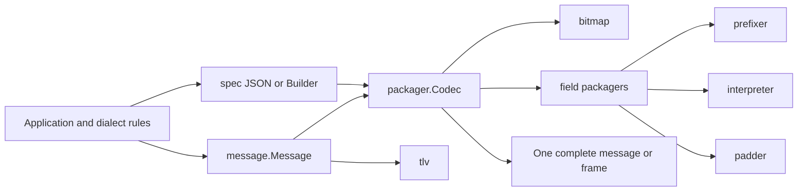

# Architecture Overview

The library separates message data from field encoding and complete message
layout. Applications compile a layout once and pass messages through it.

## Package responsibilities

1. `message` owns in-memory message values and composite access.
2. `spec` parses JSON definitions or accepts builder calls, resolves encoding
   strategies, and asks `packager` to compile the layout.
3. `packager.Codec` holds the compiled layout and serializes or parses one
   complete message.
4. `bitmap` encodes bitmap blocks. `field` delegates individual values to
   prefixers, interpreters, padders, and TLV operations.
5. Applications keep transaction requirements, response decisions, security
   key access, and stream framing outside the codec.

## Packing flow

`Codec.Pack` checks the configured header and MTI, checks each active field
against the compiled definitions, creates bitmap indicators, then writes
fields in numeric order. If configured, it adds the transport length prefix
after assembling the message body.

## Unpacking flow

`Codec.Unpack` verifies the configured frame length, reads the header and MTI,
decodes the bitmap, and decodes active fields in numeric order. It returns an
error with field and byte-offset context if an active field has no definition,
if a field cannot decode, or if bytes remain after the message.

The caller reads enough bytes to provide one complete frame. The codec does
not read from TCP or buffer a sequence of messages.

## Extension points

Implement `field.FieldPackager`, `prefixer.Prefixer`, `interpreter.Interpreter`,
or `padder.Padder` when a wire format needs behavior outside the built-ins.
Add JSON resolver names only when JSON-defined layouts should use the new
strategy. Custom field packagers should validate immutable configuration
during compilation and remain immutable when a compiled codec is shared.

For a network dialect, use an application package such as
`your-project/specs/custom`. Load the dialect's field layout there and add a
separate validator for MTI-specific required fields. This keeps network
policy out of the generic serialization packages.

## Concurrency and performance boundaries

Compiled codecs expose no layout mutators. Built-in field strategies can be
shared for concurrent calls; custom strategies must also be immutable.
Message locks protect map operations, not a transaction spanning several
calls. The caller must give one goroutine ownership of a message while it is
being changed or serialized.

The module includes benchmarks under the root package. Results depend on the
message layout, Go version, and machine. Use those benchmarks to support any
performance claim for a specific deployment.
